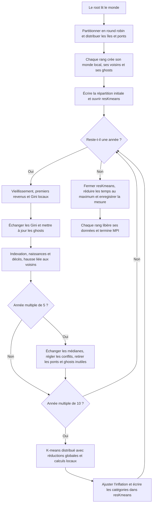

# Version dans `parallel`

Documentation technique de la simulation et des benchmarks.

## Compilation et exécution

Depuis la racine du projet, compiler et lancer la version séquentielle avec `g++`.

```bash
cd parallel
g++ -std=c++11 -Wall -Wextra -pedantic -Iinclude src/main.cpp src/monde.cpp src/ile.cpp src/habitant.cpp -o simulation
./simulation
```

### Démarrage MPI

Depuis `parallel/`, compiler et lancer la version MPI.

```bash
mpic++ -std=c++11 -Wall -Wextra -pedantic -Iinclude -Irepartion_de_base/round_robin src/mainPara.cpp src/ile.cpp src/ile_portable.cpp src/habitant.cpp src/fonction_simulation.cpp repartion_de_base/round_robin/round_robin.cpp -o monde_mpi
mkdir -p LOGS
mpirun -np 3 ./monde_mpi ../fichierMondes/monde1.txt 1 10 42
```

Les arguments de `monde_mpi` sont le chemin du monde, le rang root, le nombre d'années et la graine facultative. Le rang root est compris entre 0 et le nombre de processus moins un.

Le programme écrit ses fichiers dans `LOGS`, dans le répertoire depuis lequel on le lance.

## Mondes de benchmark

Les quinze fichiers sont dans [`monde/`](../monde/). Pour un niveau donné, les trois catégories ont les mêmes îles dans le même ordre et la même population dans chaque île. Le réseau `sparse` est inclus dans `balanced`, qui est lui-même inclus dans `dense`. Les trois réseaux sont connexes au départ.

| Charge | Îles | Population totale | Ponts sparse | Ponts balanced | Ponts dense |
| --- | ---: | ---: | ---: | ---: | ---: |
| tiny | 16 | 1 280 | [20](../monde/sparse/tiny.txt) | [48](../monde/balanced/tiny.txt) | [96](../monde/dense/tiny.txt) |
| small | 96 | 15 360 | [120](../monde/sparse/small.txt) | [576](../monde/balanced/small.txt) | [2 304](../monde/dense/small.txt) |
| medium | 512 | 131 072 | [640](../monde/sparse/medium.txt) | [3 072](../monde/balanced/medium.txt) | [16 384](../monde/dense/medium.txt) |
| large | 2 048 | 1 048 576 | [2 560](../monde/sparse/large.txt) | [12 288](../monde/balanced/large.txt) | [65 536](../monde/dense/large.txt) |
| extreme | 8 192 | 6 291 456 | [10 240](../monde/sparse/extreme.txt) | [49 152](../monde/balanced/extreme.txt) | [262 144](../monde/dense/extreme.txt) |

Les fichiers de monde `.txt` ont été générés par IA. Ils suivent le format de `monde1.txt`, avec le nombre d'îles, les lignes `numéro nom population`, le nombre de ponts, puis les paires de numéros d'îles.

Exemple depuis `parallel/`, avec le dossier `LOGS` déjà présent.

```bash
mpirun -np 8 ./monde_mpi ../monde/dense/extreme.txt 0 10 42
```

## Script de benchmark

Depuis la racine du projet, lancer [`benchmark.sh`](../benchmark.sh).

```bash
./benchmark.sh
```

Le script crée `LOGS` si besoin et compile une fois le binaire MPI `benchmark` avec `-O3`. Il parcourt les catégories dans l'ordre `balanced`, `dense`, `sparse`, puis les fichiers de chaque catégorie par ordre alphabétique. Pour chaque monde, il lance la simulation de 1 à `MAXnprocs` processus, avec le rang 0 comme root.

Les réglages se modifient en haut du script. La configuration actuelle utilise `MAXnprocs=8`, `ANNEES=20` et `GRAINE=42` pour la simulation. Cela donne 120 lancements pour les 15 mondes.

Après chaque lancement, le script lit le temps dans la dernière ligne de `LOGS/STATS.TXT`, puis affiche et ajoute la ligne correspondante à `LOGS/resultat.txt`. Les formats sont détaillés dans [Fichiers de sortie](#fichiers-de-sortie).

## Ordre d'exécution MPI

1. **Démarrage.** Le root lit les descriptions d'îles et les range dans `envoi`, par bloc de destination. Un pont entre deux rangs figure dans leurs deux blocs de `envoi_ponts`. Les tailles et déplacements sont en octets. Pour les ponts, `prochaine_case` suit la prochaine position libre dans chaque bloc.
2. **Répartition.** `MPI_Bcast` partage la graine. Les appels à `MPI_Scatter` donnent la taille des tampons à allouer, puis `MPI_Scatterv` remplit `mes_descriptions` et `mes_ponts`. Chaque rang crée ensuite ses habitants, ses listes de voisins et un ghost par île distante reliée. Les rangs écrivent ensemble la répartition initiale dans `LOGS/LOGS.TXT`.
3. **Chaque année.** Les habitants vieillissent et les nouveaux majeurs reçoivent un premier revenu. Les rangs calculent puis partagent les Gini avec leurs voisins. Ils indexent ensuite les revenus, remplacent les morts par des nouveau-nés et accordent une seule hausse de 5 % aux moins de 25 ans si une île voisine a un Gini supérieur.
4. **Tous les cinq ans.** On calcule les médianes après les règles de l'année et on les échange entre voisins distants. On traite les conflits dans l'ordre d'origine des ponts. L'écart est mesuré par rapport à la médiane la plus haute. À partir de 5 % d'écart, l'île riche lance quatre dés et l'autre deux. L'île riche doit obtenir un meilleur lancer strictement supérieur pour fermer le pont. Les deux extrémités mettent leurs listes à jour, puis chaque rang enlève les ghosts devenus inutiles.
5. **Tous les dix ans.** Après les conflits de ponts, les rangs calculent le Gini, le revenu moyen et l'âge moyen de chaque île sur l'état de fin d'année. Ils normalisent les trois valeurs à l'échelle mondiale et font converger un K-means distribué. Les groupes sont classés par Gini décroissant et les catégories 1, 2 et 3 ajustent l'inflation de −0,5, 0 et +0,5 point. Le nouveau taux sert aux indexations suivantes.
6. **Fin.** Les rangs ferment `LOGS/resKmeans` et mesurent leur temps écoulé. Le root affiche le maximum et l'ajoute à `LOGS/STATS.TXT`. Chaque rang libère ses données avant `MPI_Finalize`.

### Architecture MPI



| Primitives MPI | Rôle dans le programme |
| --- | --- |
| `MPI_Init`, `MPI_Comm_rank`, `MPI_Comm_size`, `MPI_Finalize` | Démarrer et terminer MPI, identifier le rang et connaître le nombre de processus. |
| `MPI_Bcast` | Diffuser la graine globale depuis le root, puis les coordonnées de chaque centre initial depuis son rang propriétaire. |
| `MPI_Scatter`, `MPI_Scatterv` | Distribuer d'abord les tailles en octets, puis les blocs de descriptions et de ponts. |
| `MPI_Irecv`, `MPI_Isend`, `MPI_Waitall` | Échanger les Gini ou les médianes avec les rangs voisins, puis attendre la fin des communications avant de lire les tampons. |
| `MPI_Sendrecv` | Échanger les meilleurs lancers aux deux extrémités d'un pont distant en conflit. |
| `MPI_Allreduce` | Partager les totaux de normalisation et de K-means avec `MPI_SUM` et identifier les centres initiaux avec `MPI_MINLOC`. |
| `MPI_File_open`, `MPI_File_set_size`, `MPI_File_write_ordered`, `MPI_File_close` | Créer ou vider les fichiers MPI-IO et y écrire collectivement la répartition initiale et les catégories, dans l'ordre des rangs. |
| `MPI_Barrier`, `MPI_Reduce` | Synchroniser le départ du chrono, puis transmettre au root le maximum des durées avec `MPI_MAX`. |
| `MPI_Error_string`, `MPI_Abort` | Afficher un diagnostic MPI-IO et interrompre le programme en cas d'erreur fatale. |

## Catalogue des fonctions

### Démarrage et durée de vie des données

| Fonction | Fichier | Rôle |
| --- | --- | --- |
| `main` | `src/mainPara.cpp` | Orchestre le démarrage MPI, la répartition, la simulation et la sortie des résultats. |
| `creer_ile_portable` | `src/ile_portable.cpp` | Lit le numéro, le nom et l'effectif d'une île pour l'envoi par le root. |
| `rang_round_robin` | `repartion_de_base/round_robin/round_robin.cpp` | Choisit le rang à partir de la position de l'île dans le fichier. |
| `convertir_ile` | `src/ile.cpp` | Transmet la description reçue et le générateur de l'île à `creer_ile`. |
| `creer_ile(num, nom, nb_hab, inflation, generateur)` | `src/ile.cpp` | Alloue l'île et appelle `creation_habitant` pour remplir sa population. |
| `creation_habitant` | `src/habitant.cpp` | Crée le nom, tire l'âge et initialise le revenu d'un habitant. En MPI, le revenu des mineurs démarre à zéro. |
| `ecrire_repartition` | `src/mainPara.cpp` | Écrit les effectifs et le monde local de chaque rang juste après la répartition. |
| `ajouter_statistique` | `src/mainPara.cpp` | Appelée par le root pour ajouter une mesure à `LOGS/STATS.TXT`. |
| `liberer_ile` | `src/ile.cpp` | Libère les habitants avec `liberer_habitant`, puis leur tableau et l'île. |
| `liberer_habitant` | `src/habitant.cpp` | Libère un habitant. |

### Règles annuelles et conflits de ponts

| Fonction | Fichier | Rôle |
| --- | --- | --- |
| `vieillir_tout_le_monde` | `src/fonction_simulation.cpp` | Augmente les âges et renvoie le tableau temporaire des nouveaux majeurs. |
| `donner_premier_revenu` | `src/fonction_simulation.cpp` | Tire le premier revenu de chaque nouveau majeur avec le générateur de son île. |
| `calculer_gini` | `src/fonction_simulation.cpp` | Calcule le Gini d'une île à partir des écarts entre ses revenus. Sert aussi à l'enquête des dix ans. |
| `calculer_gini_locaux` | `src/mainPara.cpp` | Met à jour les Gini des îles locales et produit un tableau à deux cases par île. |
| `remplir_ghosts` | `src/mainPara.cpp` | Envoie le numéro et la valeur de chaque île concernée une fois par rang voisin. Le tag MPI indique si la valeur reçue est un Gini ou une médiane. |
| `indexer_revenus` | `src/fonction_simulation.cpp` | Applique le taux d'inflation de l'île aux revenus des majeurs. |
| `vie_et_mort` | `src/fonction_simulation.cpp` | Tire un nombre de décès jusqu'à 5 % de la population et réutilise les emplacements pour les nouveau-nés. |
| `hausse_n_pour_cent_pour_moins_de_t_ans` | `src/fonction_simulation.cpp` | Augmente de `n` % les revenus des habitants d'âge strictement inférieur à `t`. La boucle annuelle lui passe 5 et 25. |
| `revenue_median` | `src/fonction_simulation.cpp` | Trie une copie des revenus pour calculer la médiane. |
| `comparer_revenus` | `src/fonction_simulation.cpp` | Compare deux revenus pour le tri `qsort` de la médiane. |
| `traiter_conflits_ponts` | `src/mainPara.cpp` | Compare les médianes, fait les lancers, échange les résultats des ponts distants et compacte le tableau des ponts conservés. |
| `lancer_de_n` | `src/fonction_simulation.cpp` | Appelle `lancer_de` n fois et conserve le maximum. |
| `lancer_de` | `src/fonction_simulation.cpp` | Tire un entier de 1 à 6 avec le générateur de l'île. |
| `retirer_pont` | `src/fonction_simulation.cpp` | Enlève une liaison dans chaque liste locale disponible. |
| `retirer_voisin` | `src/fonction_simulation.cpp` | Retire une entrée et décale les suivantes dans une liste. |
| `retirer_ghosts_sans_pont` | `src/mainPara.cpp` | Compacte les ghosts encore utilisés par une île locale et met à jour l'index par numéro. |

### Enquête et résultats K-means

| Fonction | Fichier | Rôle |
| --- | --- | --- |
| `calculer_caracteristiques_locales` | `src/mainPara.cpp` | Prépare un tableau à trois cases par île avec le Gini, le revenu moyen et l'âge moyen. |
| `normaliser_caracteristiques` | `src/mainPara.cpp` | Centre et réduit les valeurs à partir des sommes et des sommes de carrés globales. Une variance calculée non positive donne une colonne à zéro. |
| `initialiser_centres` | `src/mainPara.cpp` | Sélectionne les îles aux plus petits numéros avec `MPI_MINLOC` et diffuse leurs coordonnées. |
| `affecter_groupes_kmeans` | `src/mainPara.cpp` | Affecte les îles au centre le plus proche et partage les sommes par groupe. Arrête les itérations quand les affectations se stabilisent. Un groupe vide garde son centre précédent. |
| `appliquer_categories_kmeans` | `src/mainPara.cpp` | Classe les centres par Gini décroissant, transforme les numéros de groupe en catégories et ajuste l'inflation. |
| `ecrire_resultats_kmeans` | `src/mainPara.cpp` | Formate les lignes locales et les écrit collectivement dans `LOGS/resKmeans`. |
| `verifier_fichier_mpi` | `src/mainPara.cpp` | Affiche le chemin concerné et arrête le programme si une opération sur un fichier MPI échoue. |

### Entrée séquentielle dans `parallel`

| Fonction | Fichier | Rôle |
| --- | --- | --- |
| `main` | `src/main.cpp` | Lit, affiche et libère le monde de démonstration. |
| `generation` | `src/monde.cpp` | Lit les îles et construit la matrice d'adjacence. |
| `creer_ile(fichier)` | `src/ile.cpp` | Lit une description et appelle l'autre version de `creer_ile`. |
| `affichage_monde` | `src/monde.cpp` | Affiche les îles et leur matrice d'adjacence. |
| `affichage_ile` | `src/ile.cpp` | Affiche une île en appelant `affichage_habitant` pour chaque personne. |
| `affichage_habitant` | `src/habitant.cpp` | Affiche le nom, l'âge et le revenu d'un habitant. |
| `liberer_monde` | `src/monde.cpp` | Libère les îles, la matrice d'adjacence et le monde. |

La version d'origine dans [`Sequentiel/`](../Sequentiel/) regroupe les mêmes opérations de démonstration dans `monde.cpp` avec `generation`, `creation_habitant`, `affichage_monde`, `affichage_ile`, `affichage_habitant` et `liberer_monde`. Son `main.cpp` enchaîne lecture, affichage et libération.

## Complexité algorithmique

On note `P` le nombre de rangs, `N` le nombre d'îles et `E` le nombre de ponts actifs. Pour le rang `r`, `N_r` est son nombre d'îles, `E_r` son nombre de ponts locaux ou incidents et `A_r` le nombre d'entrées dans ses listes de voisins. Un pont entre deux rangs figure dans les deux tableaux de ponts. Ainsi, la somme des `E_r` est au plus `2E` et celle des `A_r` aussi. `G_r` désigne le nombre de ghosts distincts et `V_r` le nombre de rangs voisins.

Pour une île `i` de `h_i` habitants, on utilise `H_r = Σ h_i`, `Q_r = Σ h_i²` et `M_r = Σ h_i log(h_i + 1)`, avec des sommes sur les îles du rang. Les quantités `H`, `Q` et `M` sont les sommes sur tous les rangs. Le round robin équilibre le nombre d'îles à une unité près. Des populations différentes peuvent produire des charges `H_r` et `Q_r` inégales.

Les accès aux tables de hachage sont supposés en temps constant en moyenne. Le travail global cumule les opérations locales. Le temps écoulé dépend aussi de la répartition de ce travail, des communications et des entrées-sorties.

| Opération | Travail local par rang | Travail global | Mémoire supplémentaire |
| --- | --- | --- | --- |
| Gini | Pour une île, O(h_i²) avec les deux boucles. O(h_i) si la somme des revenus est nulle. Au plus O(N_r + Q_r) pour le rang. | O(N + Q) par passage sur toutes les îles. | O(1) par appel à `calculer_gini`, plus O(N_r) pour le tableau des valeurs du rang. |
| Médiane | O(N_r + M_r) par échéance de cinq ans, sous l'hypothèse d'un `qsort` en O(h_i log h_i). | O(N + M) par échéance. | O(h_i) pour la copie des revenus. Une seule copie d'île est traitée à la fois sur chaque rang, hors espace interne de `qsort`. |
| Règles annuelles ordinaires | O(N_r + H_r + Q_r + A_r) au pire pour le vieillissement, les revenus, les décès, le Gini et la recherche d'une voisine plus inégalitaire. | O(N + H + Q + E) par année, hors échange des Gini et échéances de cinq et dix ans. | O(N_r + max h_i) sur le rang pour les valeurs des îles et le tableau temporaire des nouveaux majeurs. |
| Partitionnement round robin | O(1) pour `rang_round_robin` par île. Le root lit et prépare tous les blocs en O(N + E + P). Chaque rang crée ensuite ses îles et habitants en O(N_r + H_r). | O(N + E + P + H) au démarrage, hors coût des collectives. | O(N + E + P) pour la préparation sur le root, puis O(N_r + H_r + E_r) pour le monde du rang et ses listes et tampons à la réception. |
| Ponts et ghosts | Construire les listes et les ghosts coûte O(N_r + E_r). Un échange avec des ghosts coûte au pire O(P + G_r + V_r × (N_r + A_r)) pour préparer et lire les messages. Sans ghost, la fonction revient en O(1). | O(N + E) pour la construction, puis la somme des coûts locaux pour chaque échange. | O(P + E_r + G_r) pour les tampons et requêtes d'un échange. Les tableaux de ponts et de ghosts gardent leur capacité initiale après compactage. |
| Fermetures de ponts | O(E_r + C_r × Δ_r), où `C_r` est le nombre de ponts fermés sur le rang et `Δ_r` le degré maximal d'une île locale. Retirer un lien peut nécessiter une recherche puis un décalage. Après une fermeture, le nettoyage des ghosts coûte O(N_r + A_r + G_r). | Somme des coûts locaux. Chaque pont distant en conflit déclenche un échange d'un entier par extrémité. | O(G_r) pour marquer les ghosts à conserver. Les ponts et les listes sont compactés sur place. |
| K-means distribué | Préparer les caractéristiques coûte O(N_r + H_r + Q_r), puis les normaliser coûte O(N_r × d). Pour `k` centres et `d` caractéristiques, l'initialisation coûte O(k × (N_r + d)), les `T` itérations coûtent O(T × (N_r × k × d + k × d)) et le classement coûte O(k² + N_r). | O(N + H + Q) pour les caractéristiques, O(N × d) pour la normalisation et O(k × (N + P × d)) pour l'initialisation. Les itérations coûtent O(T × (N × k × d + P × k × d)), puis le classement O(P × k² + N). | O(N_r × d + N_r + k × d) pour les caractéristiques, les affectations et les centres, hors tampon d'écriture. |

Pour les ghosts, le rang parcourt ses listes pour chaque rang voisin et envoie un message groupé par destination. Chaque couple île locale–rang destinataire est envoyé une seule fois, sous la forme de deux `double`.

Pour K-means, `d = 3` et `k ≤ 3`. La normalisation fait un `MPI_Allreduce` de 7 `double`. Chaque centre initial demande une réduction `MPI_MINLOC` et une diffusion. Chaque itération fait un `MPI_Allreduce` de 13 `double`, quelle que soit la quantité d'îles du rang. `T` dépend de la stabilisation des affectations. Les coûts des collectives dépendent de l'implémentation MPI et du placement des rangs.

## Fichiers de sortie

| Fichier | Contenu | Écriture |
| --- | --- | --- |
| `LOGS/STATS.TXT` | Trois champs séparés par des tabulations, sans en-tête. Le chemin du monde, le nombre de processus et le temps en secondes. Le nombre d'années est absent. | Le root ajoute une ligne par simulation terminée. |
| `LOGS/resultat.txt` | Tableau avec en-tête et quatre champs séparés par `\|`. Le monde, le nombre de processus, le temps en secondes et `Nb itérations`, qui correspond à `ANNEES`. | Le script ajoute un bloc par benchmark et termine le bloc par `==================` si tous les lancements aboutissent. |
| `LOGS/LOGS.TXT` | Un bloc par rang avec ses îles, ses effectifs et l'état du monde juste après la répartition. | Réécrit une fois par lancement. |
| `LOGS/resKmeans` | CSV `annee,ile,categorie`, avec une ligne par île pour chaque enquête des années 10, 20, 30, etc. | Vidé au début de chaque simulation, puis alimenté par blocs ordonnés par rang à chaque enquête. Seul l'en-tête est écrit avant la première enquête. |

## Mesure des performances

1. Chaque rang relève `start` avec `std::chrono::system_clock` juste après la barrière de départ, après `MPI_Init` et la validation des arguments, avant que le root lise le monde.
2. Le temps inclut la lecture, le partitionnement, la distribution, la construction des mondes locaux, la simulation et ses communications. Il inclut aussi l'ouverture, les écritures et la fermeture de `LOGS/resKmeans`. Chaque rang soustrait le temps passé dans `ecrire_repartition`, qui couvre la préparation du texte et l'écriture collective de `LOGS/LOGS.TXT`.
3. Chaque rang relève `end` juste après la fermeture de `LOGS/resKmeans` et calcule sa durée locale en secondes avec `end - start - duree_logs`. Le root reçoit le maximum de ces durées via `MPI_Reduce` avec `MPI_MAX`, l'affiche et l'ajoute à `LOGS/STATS.TXT`.

La compilation, le lancement de `mpirun`, l'initialisation MPI, la barrière de départ, la réduction finale des temps, l'écriture dans `STATS.TXT` et `resultat.txt`, la libération finale des données et `MPI_Finalize` sont hors mesure. Le script compile avec `mpic++ -O3 -std=c++11`, en utilisant les en-têtes de `parallel/include` et du round robin.

Le résultat est le maximum des durées locales après soustraction du log sur chaque rang. Il diffère du temps mural complet d'un lancement, en particulier si les rangs attendent pendant l'écriture du log. `system_clock` peut être ajustée pendant la mesure. Les temps peuvent aussi varier avec le placement des rangs, la charge de la machine et les performances du système de fichiers.

### Machine de développement

La machine utilise un Intel Core i5-13420H à architecture hybride, avec 4 cœurs Performance (P-cores), 4 cœurs Efficient (E-cores), 8 cœurs physiques et 12 processeurs logiques. `lscpu` indique 12 Mio de cache L3. [Fiche Intel](https://www.intel.com/content/www/us/en/products/sku/232173/intel-core-i513420h-processor-12m-cache-up-to-4-60-ghz/specifications.html)

Les premiers essais sur `balanced/extreme` pendant 10 ans donnent 30,74 s à 1 rang, 15,46 s à 2 rangs, 10,37 s à 3 rangs et 7,82 s à 4 rangs. L'accélération est presque linéaire jusqu'à 4 rangs. Le temps remonte à 12,46 s à 5 rangs. L'architecture hybride pourrait contribuer à cette dégradation si le placement introduit un rang plus lent. Pour vérifier cette hypothèse, il faut relever le placement effectif des rangs et répéter les mesures avec un placement contrôlé.

Lors du dimensionnement des mondes, il restait environ 9 Gio de mémoire disponible. Sur `dense/extreme`, l'essai avec `-O2` et la graine 42 a pris environ 8,1 s pour 10 ans à 8 rangs. Le plus gros pic mémoire d'un rang était de 128 Mio et la somme des pics RSS individuels de 796 Mio. Les pics des rangs peuvent survenir à des instants différents. À 1 rang pour 1 an, le pic était de 611 Mio. Pour ce monde, `LOGS/LOGS.TXT` occupe environ 151 Mio.

## Reproductibilité et validation

Le root lit la graine fournie en argument ou utilise `std::time(nullptr)` si elle est omise. Il diffuse `seed_globale` à tous les rangs. Chaque île initialise son propre `std::mt19937` avec `seed_globale + num`, où `num` est son numéro. Le même générateur suit l'île pour la population initiale, les nouveaux revenus, les décès et les lancers de dés. À paramètres identiques, changer le nombre de processus conserve la graine initiale de chaque île. Les ponts sont parcourus dans l'ordre du fichier et les centres initiaux sont choisis par numéro d'île.

Pour comparer deux exécutions, garder le même monde, le même nombre d'années, la même graine explicite et le même binaire. Conserver le CSV de chaque exécution, par exemple dans `run-1/LOGS/resKmeans` et `run-3/LOGS/resKmeans`. Vérifier l'en-tête et le nombre de lignes, puis comparer les catégories par couple `(annee, ile)`. Les rangs peuvent écrire les lignes dans un ordre différent.

```bash
diff -u \
    <(tail -n +2 run-1/LOGS/resKmeans | sort -t, -k1,1n -k2,2n) \
    <(tail -n +2 run-3/LOGS/resKmeans | sort -t, -k1,1n -k2,2n)
```

Avec `monde1.txt`, 10 ans et la graine 42, cette comparaison a donné les mêmes catégories à un et à trois rangs.

Les sommes flottantes de la normalisation et de K-means peuvent être regroupées et additionnées dans un ordre différent quand le nombre de rangs change. Les arrondis peuvent alors modifier les centres ou une catégorie près d'une frontière, puis le taux d'inflation et l'évolution des années suivantes. La graine fixe contrôle les tirages, avec une reproductibilité numérique qui dépend aussi du compilateur et des bibliothèques utilisés. [Standard MPI sur les réductions](https://www.mpi-forum.org/docs/mpi-4.1/mpi41-report/node130.htm)
